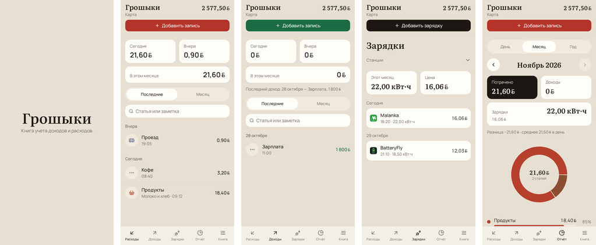

# Грошыки

Книга доходов и расходов. Считается на телефоне. Вход и регистрация не нужны: записи остаются на этом устройстве.

После установки книга пустая. Счета, статьи и операции появляются, когда в разделе «Книга» загружаете выгрузку из «Деньги OK». Лучше Excel: в нём есть время операции.

## Как выглядит

Цифры на снимках выдуманы.

## Запись

Внизу пять разделов: **Расходы**, **Доходы**, **Зарядки**, **Отчёт**, **Книга**.

Чтобы добавить расход или доход, нажмите большую кнопку вверху. Сумму набирайте клавиатурой Грошыки, выберите статью и нажмите «Готово». Клавиатура телефона открывается только для названий и заметок.

В списках расходов и доходов сверху видно, сколько вышло сегодня, вчера и в этом месяце. Сюда же входят зарядки. Цифры написаны тем же шрифтом, что и названия статей. Искать можно по статье или заметке. Новая запись открывается без выбранной статьи.

## Отчёт

День, месяц или год. Карточки «Потрачено» и «Доходы» переключают диаграмму. В «Потрачено» входят и зарядки. Карточка «Зарядки» показывает киловатт-часы, деньги и разбивку по станциям за тот же период.

## Зарядки

Отдельный список. Те же записи видны и в расходах: станция, киловатт-часы и сумма за месяц. Станцию можно выбрать из готовых или завести свою: название и значок, как у статьи.

В записи указываются киловатт-часы и цена за кВт·ч. Нажмите нужное поле и наберите его клавиатурой Грошыки внизу экрана. Сумма считается сама. «Готово» — в шапке окна.

## Книга

Здесь счета, статьи, копии и настройки.

**Показывать остаток** включает сумму в шапке и в этом разделе. Это текущий остаток счёта, не оборот за всё время. Пока переключатель выключен, сумма скрыта.

Валюта учёта выбирается списком: белорусский рубль, доллар, евро или российский рубль. Суммы не пересчитываются, меняется только знак.

Расходы и доходы всегда внизу. **Зарядки**, **Отчёт**, **Расчёт** и **Другое** включаются в Книге.

**Расчёт** считает депозит и кредит по кнопке «Посчитать» и ничего не записывает. У депозита есть срок в днях, месяцах или годах, капитализация и необязательный ежемесячный взнос. У кредита платежи равными частями или с уменьшающимся остатком.

**Другое** после включения стоит в нижнем меню. Перед этим задаётся цифровой пароль. Он спрашивается каждый раз при входе в раздел. Внутри помощь, отложенная валюта и депозиты. Сумма пишется в выбранной валюте — евро, доллар, российский рубль или белорусский рубль. Курса нет. Это не доход и не остаток книги.

Начальный остаток счёта тоже набирается клавиатурой Грошыки. Он может быть отрицательным: знак меняет кнопка ±.

**Загрузить выгрузку MoneyOK** берёт Excel или CSV из «Деньги OK» и заменяет книгу целиком: счета, статьи, группы и операции встают как в файле. CSV тоже подойдёт, но без времени суток.

Копию можно скачать файлом JSON или CSV. На телефоне откроется окно «Сохранить»: выберите «Загрузки» или Диск. Загрузка выгрузки открывает выбор файла.

Телефон, если включено резервное копирование Google, сам хранит книгу среди данных приложений. Отдельного файла на Диске при этом нет. После удаления Грошыки та же сборка на том же аккаунте Google поднимает последнюю такую копию. Обновление поверх уже стоящей версии книгу не трогает и облако не подставляет. Записи, сделанные после последней копии телефона, в ней не появятся. Перед удалением надёжнее ещё скачать JSON.

## Версия

Сейчас **1.5.12**. Суммы пишутся с графическим знаком белорусского рубля. Список изменений — в [docs/CHANGELOG.md](docs/CHANGELOG.md).

Обновление приложения книгу не удаляет: она остаётся на этом телефоне. Удаление стирает её с телефона. Вернуть можно из резервной копии Google, если она была включена, или из скачанного JSON.

На Android файл ставится из [релизов](https://github.com/MaksR89/Groshiki/releases). Поверх уже установленной Грошыки: `adb install -r`. Экран не залезает под часы, кнопки телефона и клавиатуру.